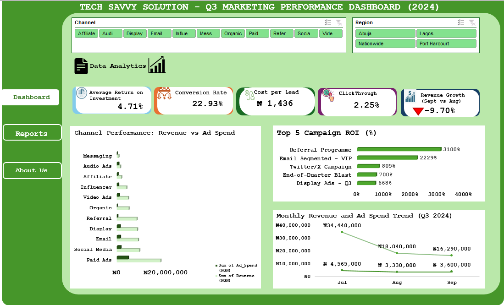

# Tech-Savvy-Marketing-Campaign-Analysis
An Excel-based marketing campaign performance analysis for Tech Savvy Solutions, examining Q3 campaign profitability, channel performance, ROI, customer conversions, campaign segmentation, and Q4 revenue projections.

# Tech Savvy Solutions: Marketing Campaign Performance Analysis

## Project Overview

This project presents an end-to-end marketing campaign performance analysis for Tech Savvy Solutions, a simulated technology business seeking to evaluate the effectiveness of its marketing activities and make more informed budget allocation decisions.

Using Microsoft Excel 2016, I analysed third-quarter (Q3) marketing campaign data covering July to September to assess campaign profitability, advertising efficiency, channel performance, lead generation, and conversion outcomes.

The analysis also explores campaign segmentation, relationships between advertising spend and lead generation, competitor benchmarking, and Q4 revenue projections.

The objective was to transform raw marketing data into actionable business insights that can support better marketing decisions and improve future campaign performance.

## Business Problem

Tech Savvy Solutions needed a clearer understanding of how its marketing campaigns performed during Q3.

Although the business invested in multiple marketing channels, it needed to identify:

- Which campaigns generated the strongest return on investment.
- Which marketing channels contributed the most revenue and delivered better returns.
- Whether higher advertising expenditure translated into increased lead generation.
- Which campaigns were underperforming and required further attention.
- How Q3 performance could inform marketing priorities and revenue expectations for Q4.

Without a structured analysis, the business risked allocating marketing resources inefficiently and continuing campaigns without sufficient performance evidence.

## Project Objectives

The objectives of this analysis were to:

- Clean, validate, and prepare the marketing campaign dataset for analysis.
- Evaluate campaign performance using revenue, advertising spend, ROI, leads, and conversions.
- Compare marketing channel performance and identify stronger-performing channels.
- Examine monthly performance trends across the Q3 reporting period.
- Segment campaigns according to ROI performance.
- Investigate the relationship between advertising spend and lead generation.
- Develop Q4 revenue projections using historical monthly growth rates.
- Benchmark business performance against simulated competitors.
- Provide actionable recommendations to improve future marketing decisions.

## Dataset Overview

| Dataset Attribute | Description |
|---|---|
| Business | Tech Savvy Solutions |
| Reporting Period | July – September (Q3) |
| Total Records | 30 marketing campaigns |
| Dataset Columns | 13 original variables |
| Data Type | Structured marketing campaign data |
| Analysis Tool | Microsoft Excel 2016 |

The dataset contains campaign-level information, including:

- Campaign Name
- Marketing Channel
- Launch Date
- Advertising Spend
- Revenue
- Leads
- Conversions
- Return on Investment (ROI)
- Conversion Rate

Additional analytical fields, including Month and Campaign Segment, were created to support the analysis.

## Data Source and Privacy

The dataset was provided as part of an internship training assignment and was used for learning and analytical practice. The original data source and collection methodology were not independently verified. The dataset has been used for this portfolio project in accordance with the applicable internship instructions. 

No additional personal or confidential information has been intentionally added to the analysis.

## Tools and Techniques

### Primary Tool: Microsoft Excel 2016

The project demonstrates the use of Excel for data preparation, business analysis, reporting, and forecasting.

| Area | Techniques Used |
|---|---|
| Data Cleaning | Duplicate checks, missing-value checks, data validation, data formatting |
| Data Preparation | Calculated columns, date extraction, data standardisation |
| Data Analysis | Summary statistics, descriptive analysis, KPI calculations |
| Data Summarisation | Pivot Tables and Pivot Charts |
| Data Visualisation | Interactive dashboard, charts, and KPI cards |
| Campaign Analysis | ROI analysis and campaign performance ranking |
| Segmentation | High, Average, and Low Performer classification |
| Correlation Analysis | `CORREL` function and scatter plot with trendline |
| Forecasting | Month-over-month growth calculations and Q4 revenue projections |
| Benchmarking | Competitor comparison matrix |

## Project Workflow

**1. Data Cleaning and Preparation**

The raw dataset was reviewed and prepared for analysis.

Key activities included:

- Identifying and investigating duplicate transaction or campaign identifiers.
- Checking missing values in relevant fields.
- Standardising inconsistent currency and numerical formats.
- Reviewing calculated values for accuracy.
- Creating additional analytical fields for monthly and campaign-level analysis.
- Documenting the dataset structure and data quality observations.

A cleaned dataset was prepared for subsequent analysis.

**2. Exploratory Data Analysis**

Descriptive analysis was conducted to understand the overall distribution and performance of the marketing campaigns.

Key metrics examined included:

- Total Revenue
- Total Advertising Spend
- Average ROI
- Total Leads
- Total Conversions
- Conversion Rate

**3. Marketing Performance Dashboard**

An Excel dashboard was developed to provide a consolidated view of campaign performance.

The dashboard uses KPI summaries, Pivot Tables, and visualisations to help users monitor marketing performance and identify important trends.

The dashboard provides a visual summary of Q3 marketing campaign performance, including revenue, advertising spend, ROI, leads, and conversions.



**4. Monthly Trend Analysis**

Campaign performance was grouped into July, August, and September to examine changes across the Q3 reporting period.

The analysis considered:

- Monthly revenue
- Monthly advertising spend
- Average monthly ROI
- Monthly leads
- Monthly conversions

**5. Correlation Analysis**

The Excel CORREL function was used to examine the relationship between advertising spend and leads generated.

A scatter plot with a linear trendline and R-squared value was used to visualise the relationship.

This analysis helps assess whether higher advertising expenditure was associated with increased lead generation.

**6. Campaign Segmentation**

Campaigns were classified using ROI-based performance thresholds:

| Segment	| ROI Threshold |
|---|---|
| High Performer	| 300% and above |
| Average Performer	| 100% – 299% |
| Low Performer	| Below 100% |

This classification provides a structured way to compare campaigns and identify those requiring further review.

**7. Q4 Revenue Projection**

Q4 revenue projections were developed using the average month-over-month growth rate observed during Q3.

The projection covers:

- October
- November
- December

**Forecast assumption:** The projection assumes that the average Q3 month-over-month growth rate continues throughout Q4, with no significant changes in market conditions, marketing strategy, or business operations.

The projections are estimates, not guaranteed revenue outcomes.

**8. Competitor Benchmarking**

A competitor comparison matrix was developed to compare Tech Savvy Solutions with two simulated competitors:

- BrandPulse NG
- AdVance Digital

The comparison considered ROI, cost per lead, marketing channel, conversion rate, and revenue.

Competitor figures are illustrative and were created for the purpose of the portfolio exercise. They should not be interpreted as verified market data.

## Key Business Questions

The analysis was designed to answer the following questions:

1. Which campaigns generated the highest and lowest ROI during Q3?
2. Which marketing channels generated the most revenue?
3. Which channels delivered stronger returns relative to their performance?
4. How did marketing performance change between July and September?
5. Is there a relationship between advertising expenditure and lead generation?
6. Which campaigns should receive further investment, optimisation, or review?
7. What revenue could the business potentially generate during Q4 if the observed growth pattern continues?
8. How does Tech Savvy Solutions compare with the simulated competitors?

## Deliverables

The project includes the following deliverables:

- **Cleaned Dataset:** Prepared marketing campaign data.
-  **Data Dictionary:** Documentation of dataset fields, descriptions, formats, and data quality observations.
- **Excel Analysis Workbook:** Data preparation, formulas, Pivot Tables, charts, calculations, and analysis.
- **Marketing Performance Dashboard:** Visual summary of Q3 campaign performance.
- **Monthly Trend Analysis:** Comparison of marketing performance across July, August, and September.
- **Correlation Analysis:** Assessment of the relationship between advertising spend and leads.
- **Campaign Segmentation:** ROI-based campaign classification.
- **Q4 Revenue Projection:** Estimated October–December revenue.
- **Competitor Comparison Matrix:** Benchmarking against simulated competitors.
- **Final Analytics Report:** Business insights and strategic recommendations.
- **Business Optimisation Proposal:** Proposed improvements to marketing data management and reporting.
- **Portfolio Presentation:** Summary of the project, findings, and recommendations.

## Business Recommendations

The analysis supports three broad areas of action:

1. **Prioritise stronger-performing campaigns:** Review high-ROI campaigns and consider increasing investment where performance is sustainable and supported by sufficient evidence.
2. **Improve underperforming campaigns:** Investigate low-ROI campaigns, review their targeting, messaging, channel selection, and spending, and test improvements before making further investment decisions.
3. **Standardise marketing reporting:** Introduce a structured marketing data-entry and reporting template with consistent formats, validation rules, and reusable reporting layouts to improve data quality and reporting efficiency.

## Skills Demonstrated

Microsoft Excel 2016
Data Cleaning and Preparation
Data Validation
Exploratory Data Analysis
Business and Marketing Analytics
Pivot Tables and Pivot Charts
Excel Dashboard Development
KPI Reporting
ROI and Conversion Analysis
Campaign Segmentation
Correlation Analysis
Revenue Forecasting
Competitor Benchmarking
Business Reporting
Data-Driven Recommendations

## Project Structure

```text
Tech-Savvy-Marketing-Campaign-Analysis/
│
├── Excel_Workbook/
│   └── Tech_Savvy_Marketing_Analysis.xlsx
│
├── Reports/
│   ├── Week_1_Email.pdf
│   ├── Week_2_Insights_Report.pdf
│   ├── Week_3_Business_Intelligence_Report.pdf
|   ├── Pivot_Table.pdf
│   ├── Final_Analytics_Report.pdf
│   ├── Business_Optimisation_Proposal.pdf
│   ├── Strategic_ Recommendation_Memo.pdf
│   └── Personal_Reflection.pdf
│
├── Presentation/
│   └── Portfolio_Presentation.pptx
│
├── Images/
│   └── Marketing_Dashboard.png
│
└── README.md
```

## Conclusion

This project demonstrates how Microsoft Excel can be used to transform raw marketing campaign data into meaningful business insights.

By combining data cleaning, exploratory analysis, dashboard development, campaign segmentation, correlation analysis, forecasting, and competitor benchmarking, the project provides a structured approach to evaluating marketing performance.

Beyond reporting historical results, the analysis focuses on helping decision-makers understand what is working, identify areas requiring improvement, and make more informed marketing investment decisions.

**Analyst**: Precious Onyedum  
**Project**: Tech Savvy Solutions – Marketing Campaign Performance Analysis  
**Tool**: Microsoft Excel 2016  
**Period Analysed**: Q3 (July – September) 
